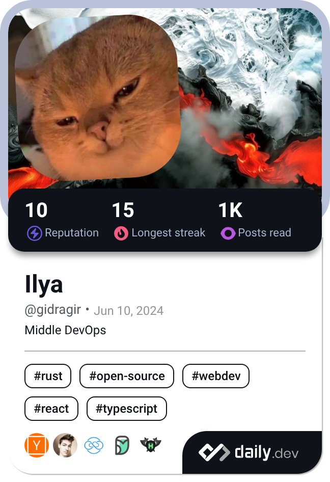

# Ilya Balter (`@gidragir`)

*Everything as Code. Automating daily routines, refining AI workflows, and building ergonomic developer tooling.*

 

  
  &nbsp;
  
  &nbsp;
  
  &nbsp;
  

---

### ⚡ What I Value & Build

- 🤖 **AI Flow & Token Ergonomics** — Designing lightweight utilities and function hooks that prepare deterministic context, minimize model token overhead, and expand agent capabilities.
- ⚙️ **Personal GitOps & IaC** — Applying infrastructure-as-code and declarative principles across daily drivers (dotfiles, cross-platform environments, automated container setups).
- 🧩 **Modular Knowledge Architecture** — Maintaining monorepos and developing high-performance plugins/renderers for personal knowledge management (PKM).
- 🛠️ **Developer Tooling & Orchestration** — Eliminating repetitive friction through CLI tooling, IDE workspace automation, and fast local workflows.

---

### 🚀 Highlighted Open Source Projects

| Project | Description | Stack |
| :--- | :--- | :--- |
| **[claude-mods](https://github.com/gidragir/claude-mods)** | Modular function-hook plugin architecture for Claude Code CLI | `TypeScript` `AI Tooling` |
| **[context-init](https://github.com/gidragir/context-init)** | Lightweight CLI for deterministic, token-efficient AI workspace context initialization | `Rust` `CLI` `LLM` |
| **[obsidian-orbit](https://github.com/gidragir/obsidian-orbit)** | Centralized monorepo SSOT for modular Obsidian plugins and shared packages | `TypeScript` `Monorepo` `PKM` |
| **[edt-worktree](https://github.com/gidragir/edt-worktree)** | Git worktree & workspace orchestrator with pre-warmed template cloning & CLI runner | `PowerShell` `Nushell` `CI/DevEx` |
| **[dotfiles](https://github.com/gidragir/dotfiles)** | Declarative, cross-platform personal environment driven by GitOps principles | `Shell` `Nushell` `GitOps` |

---

### 🛠️ Core Toolkit

| Domain | Technologies & Tools |
| :--- | :--- |
| **Automation & Systems** | `Rust` `Nushell` `PowerShell` `Bash` `Docker` `GitHub Actions` `Ansible` |
| **AI & Workflow Ergonomics** | `Claude Code Plugins` `Hermes Agent` `Context Engineering` `Agentic Automation` |
| **Web & Ecosystem** | `TypeScript` `Astro` `React` `TailwindCSS` `NestJS` `Prisma` |
| **Daily Driver & Environment** | `Obsidian` `GlazeWM` `Hyprland` `Zebar` `Starship` |

---

### 📊 Community & Activity

  <table>
    <tr>
      <td align="center" valign="top">
        
      </td>
      <td align="center" valign="top">
        
      </td>
    </tr>
  </table>

---

  Aesthetic guided by <a href="https://github.com/catppuccin/catppuccin">Catppuccin Frappé</a>.

